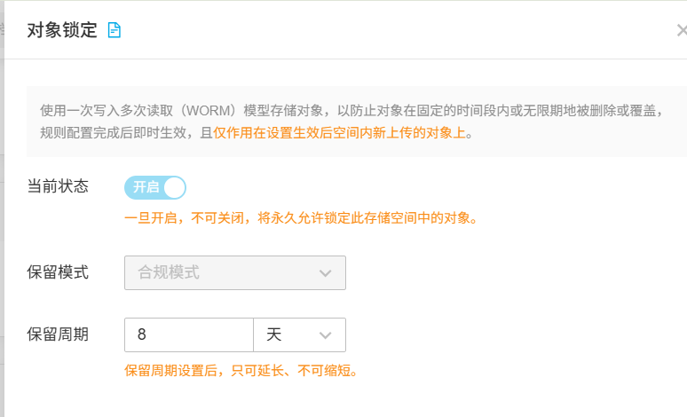

### 云备份设置

1. 七牛云设置

   A、注册七牛云帐号，并且实名认证，**认证后有10GB的免费空间可以一直使用；**

   B、找到**对象存储**下面的**空间管理**，新建空间

   C、新建好后，到空间设置中去设置**生命周期**，如果是ERP备份，可以设置删除规则为7天或者10天

   

   D、再设置**对像锁定** 建议最低设置7天的锁定期间，意味着7天以内谁都不能删除

   

   E、获取AK、SK密钥，到控制台，我的里面找到密钥管理

   

   点SK后面的**眼睛**按钮会要求输入手机验证码，确定后可以显示SK

   

2. 阿里云设置

   A、注册阿里云帐号，并且实名认证，**认证后2个月的免费使用周期；**

   B、新建桶

   C、设置桶权限

   D、到工作台，我的里面找到**访问控制**

   

   E、新建用户登录名，设置手机号和邮箱后，访问配置里面，“使用永久AccessKey”

   F、确定后，可以把AK和SK复制出来

3. 腾讯云设置

   A、注册腾讯云帐号，并且实名认证；

   B、购买腾讯云存储，再**新建桶标识**、设置生命周期

   

   如果是ERP备份，**设置生命周期**

   C、在我的里面去**安全控制**中找到用户，增加**用户**

   

   D、在用户名中，点**API密钥**，新建密钥可以获取AK和SK

   

4. 天翼云设置

   A、注册天翼云帐号，并且实名认证；

   B、开通对象存储 OOS，新建桶；

   C、在控制台的访问控制里新建用户并获取 AccessKey / SecretKey；

   D、客户端「云备份 → 天翼云」填桶名和 AK / SK，Endpoint 从天翼云控制台复制（如 jiangsu-10.zos.ctyun.cn），保存后点 **测试连接**。

5. 百度网盘设置

   A、注册百度帐号，并在百度开放平台创建应用，拿到 AppKey、AppSecret，填进程序目录的 `BaiduApp.json`；

   B、开放平台的授权回调地址必须与 `BaiduApp.json` 里的回调一致（默认 `http://127.0.0.1:17890/baidu/`），改完约 1 小时生效；

   C、客户端「云备份 → 百度网盘」点 **扫码授权** 或 **帐号密码**，授权成功后勾选启用；备份文件进入网盘的「我的应用数据 / 用心云循备」。

