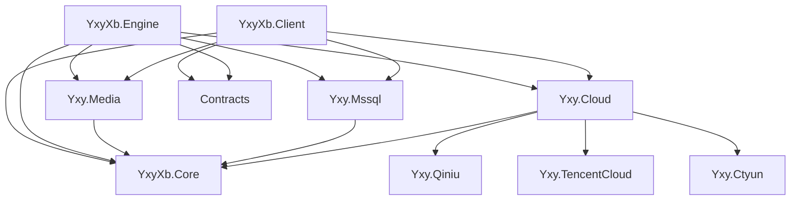

# 用心云·循备 · 开发计划

**依据：** [用心云·循备-PRD.md](用心云·循备-PRD.md)  
**预览：** [用心云·循备-本期成果预览.md](用心云·循备-本期成果预览.md)  
**现状：** 阶段 A–F 已接通。G 联调与老系统真机、双架构 zip、命名管道未收口。百度扫码/帐号密码可切换；分片日志可看；多库 zip 带库名；立即执行有运行锁。登录默认官网 HTTPS。官网 443 套件注意项见 Linux 部署手册；支付宝/百度字段见配置手册。

---

## 1. 操作系统兼容（先定这个，再定框架）

目标机包含老系统，**.NET 8 不能作为客户端/引擎的目标框架**（官方不支持 Windows 7、Server 2008 R2）。

| 系统 | 客户端 + 引擎 | 说明 |
| --- | --- | --- |
| Windows 7 SP1（32/64 位） | 必须能装能跑 | 需已装 .NET Framework 4.8；建议补齐 TLS 1.2 补丁 |
| Windows 10 / 11 | 必须 | — |
| Windows Server 2008 R2 SP1 | 必须 | 同 Win7，先装 .NET 4.8 |
| Windows Server 2012 / 2012 R2 | 必须 | — |
| Windows Server 2016 / 2019 | 必须 | — |
| Windows Server 2022（原文写的 2020，按此验收） | 必须 | 无 2020 这个版本 |

不承诺：Windows XP/Vista、未打 SP1 的 Win7/2008 R2、Windows 8.0（可尽力，不验收）。发布 **zip**，出 x86 与 x64 两套，或 AnyCPU + 32 位优先（兼容 32 位 Win7）。

**结论：客户端和引擎用 .NET Framework 4.8 + WPF + Windows Service。** 这是目前能同时盖住 Win7 / 2008 R2 到 Win11 / 2019 / 2022 的官方受支持组合。

网站部署在较新的机器上即可（Win10/11 或 Server 2016+），不要求装在 2008 R2 上。

---

## 1.1 技术选型（开工即按此建库）

| 层 | 选型 | 原因 |
| --- | --- | --- |
| 客户端 | **.NET Framework 4.8 + WPF** | 覆盖 Win7 SP1～Win11、2008 R2～2022；托盘、提权、长路径 |
| 引擎 | **.NET Framework 4.8**，`ServiceBase` 安装为 `用心云·循备 Service` | 不用 .NET 8 Worker（老系统没有运行时） |
| 本机库 | System.Data.SQLite（net48） | 单机、免装服务端、老系统可用 |
| 压缩 | System.IO.Compression（net48 自带 zip） | 与 PRD 扩展名一致 |
| MSSQL | **System.Data.SqlClient** + `BACKUP DATABASE` | 覆盖 SQL Server **2008 R2～2022**；不用最新 Microsoft.Data.SqlClient |
| 云存储 | `ICloudStorage` + 七牛 **netstandard2.0 / net48** SDK；腾讯云/天翼云空适配器 | 菜单可扩展；HTTPS 走 TLS 1.2 |
| 离线盘 | Windows API（SetupDi / IOCTL / VDS）、FlushFileBuffers | Win7 起可用；L3 在 2008 R2 上要实测 |
| 网站 | **本期不建** `Yxy.Web` | 无公网；登录占位。下期再用 ASP.NET Core 8 |
| 网站库 | 本期无 | 下期再做账户。客户端备份日志不上报 |
| 发布 | **zip**（x86 / x64 或 AnyCPU）；首次启动检测 .NET 4.8 并提示 | 本期不做 Inno / MSI |

公共契约放 `Yxy.Contracts`（**net48**）：任务 DTO、日志 DTO、设备标识。客户端与引擎同机命名管道（避免老系统本机 HTTP 监听策略问题）。

开发用 VS 2022 即可，工程目标框架一律 `net48`，语言版本锁 C# 7.3（避免生成老 JIT 不认的 IL）。禁用依赖 .NET 8 / Win11-only API。

### 1.2 老系统注意（实现时写进清单）

1. 七牛/网站 HTTPS：Win7/2008 R2 默认可能没有 TLS 1.2，安装程序或首次启动检测并提示补丁（KB3140245 等）。官网 443 须同时提供 GCM（2016+）与 ECDHE-RSA-AES256-SHA384（2012 R2），避免只开 GCM 导致老系统登不上。
2. 长路径：Win7 无「长路径策略」，继续用 `\\?\` 前缀。
3. 磁盘离线：2008 R2 / 2012 上 L3 必须用真机 U 盘测一遍，失败则该系统降级到 L2 并记日志。
4. 不使用：Win11 托盘改版 API、Windows App SDK、.NET Hosting Bundle（装在客户机上）。

---

## 2. 建议目录

```text
yxyxb/
  Doc/
  src/
    Yxy.Contracts/
    YxyXb.Core/          路径、zip、调度计算、SQLite
    Yxy.Media/         登记、挂载、拷包、隔离、巡检
    Yxy.Mssql/         连接测试、BACKUP
    Yxy.Cloud/         ICloudStorage、服务商枚举
    Yxy.Qiniu/         七牛实现
    Yxy.TencentCloud/  空实现，抛 NotSupported
    Yxy.Ctyun/         天翼云空实现，抛 NotSupported
    YxyXb.Engine/        net48 Windows Service
    YxyXb.Client/        net48 WPF
    （Yxy.Web 下期再建）
  tests/
    YxyXb.Core.Tests/
    Yxy.Media.Tests/
    Yxy.Mssql.Tests/
  YxyXb.sln
```

默认备份目录：`D:\yxyxb\bak`。测试时仍用临时目录下的 `bak`。启动时创建。

---

## 3. 阶段与工时（1 人，可并行处已标）

总工期约 **29–35 个工作日**（含 UNC/FTP/邮件与本机试用；无公网网站）。超过 30 天的阶段按周检查一次。

```mermaid
gantt
  title 本期开发顺序
  dateFormat X
  axisFormat %s
  section 骨架
  解决方案与本机库           :a1, 0, 3
  引擎空转与安装             :a2, 2, 2
  section 业务
  设置与文件备份             :b1, 4, 7
  离线介质                   :b2, 11, 8
  MSSQL                      :b3, 17, 4
  七牛与自动删除             :b4, 19, 4
  section 收口
  本机试用与登录占位         :c1, 21, 1
  首页日志联调验收           :c2, 22, 5
```



| 阶段 | 天数 | 交付物 |
| --- | --- | --- |
| A 骨架 | 3–4 | 能编译的 sln、SQLite、服务能装能启 |
| B 文件备份 | 6–7 | 添加任务、到期打 zip；源与分发 UNC/FTP 做通 |
| C 离线介质 | 7–8 | 登记、到点拷包、D/M 清理、默认 L2 隔离 |
| D MSSQL | 3–4 | 实例测试、完整备份进同一 bak |
| E 七牛+删除+邮件 | 4–5 | 上传、本机/七牛按天删、邮件发送、立即删 |
| F 授权占位 | 1 | 本机试用 30 天 + 登录占位，无网站 |
| G 联调 | 4–5 | 首页、四类日志、试用/传输验收 |

---

## 4. 阶段任务（可直接派工）

### A. 骨架（3–4 天）

1. 建 `YxyXb.sln` 与上表项目，统一品牌名「用心云循备」。
2. `YxyXb.Core`：SQLite 建表（实例、文件任务、库任务、介质、介质任务、日志、设置、授权状态）。
3. 设备标识生成并落安全存储（非计算机名）。首次启动写入 `first_run_utc`，首页显示试用剩余天数（本期不拦截）。
4. 默认 `bak` 路径 = 安装目录 `\bak`，启动创建。
5. Engine：空循环 + 读库「下次执行」；Client：壳窗口 + 导航（灰掉恢复/工具/其它库）。
6. 服务安装/启动/状态回写首页（可先做最小按钮）。

**完成标准：** 安装服务后关客户端，进程仍在；重启服务不丢库。

### B. 文件备份（6–7 天）

1. 设置页：存储路径、命名预览、网络传输、FTP、综合（开机/托盘/客户标识）。
2. 添加文件任务表单与校验（源存在、不回环、周期合法）。源支持本地 / UNC / FTP。
3. 调度：按周期算下次执行；仅一次不续算。
4. Engine：枚举源（含 UNC/FTP）、zip、写到 bak 命名目录；占用文件跳过并记日志。
5. 任务勾选网络/FTP 后，把当次 `.zip` 拷到 UNC 或上传 FTP；失败则任务失败。
6. 任务列表：启用状态、已执行、下次执行、刷新。
7. 日志页「文件备份」只读列表。

**完成标准：** 选本机一文件夹，到期后 bak 出现 `.zip`；UNC 源能打 zip；勾选网络/FTP 后目标处能看到包。

### C. 离线介质（7–8 天）

1. `Yxy.Media`：枚举可移动盘、读序列号/签名/容量、写/读 marker。
2. 登记 UI：接入 → 展示身份 → 确认；他机标记拒绝。
3. 任务 UI：第 6.2 节字段；源只读。
4. 任务开始时间与介质离线时间（可跨零点）。到开始时间检查介质是否在线，未在线则先挂载再拷贝。勾选完成后立即离线则拷贝结束马上离线；到介质离线时间若仍在线再离线一次。盘未就位则等待，超时或到离线时间仍没有盘则跳过。
5. 拷包：相对路径 + 大小 + mtime；yxypart 改名；Flush + LOCK/DISMOUNT。
6. 版本 json + D/M 先到先清。
7. L3 默认隔离；L1/L2 可选；安全四条拒绝并记安全事件。
8. 巡检与「疑似篡改」；任务可选 SHA-256（默认关，仍用大小+mtime）；日志页「离线介质」。不做轮换池。

**完成标准：** 已登记盘在任务开始时间后自动拷新包；默认拷贝完成即离线，介质离线时间再检查一次；错盘不写；第二次无新包复制数为 0。

### D. MSSQL（3–4 天）

1. 实例对话框 + 连接测试。
2. 添加库任务：选实例、库范围、周期、后处理勾选位（先接本机 zip）。
3. Engine：`BACKUP DATABASE` → zip → 同一 bak 规则。
4. 日志页「数据库备份」。

**完成标准：** 连本机 SQL Server（验收至少覆盖 2008 R2 与 2016+ 各一台），不含系统库打出 zip；离线任务到任务开始时间后能扫到该包。

### E. 云备份菜单 + 邮件 + 自动删除（4–5 天）

1. 左侧「云备份」页：服务商列表。七牛云可保存/测试/脱敏回显；百度网盘浏览器授权（可扫码）；腾讯云、天翼云禁用并提示后续开通。
2. `ICloudStorage` + 七牛实现；另两个适配器占位。
3. 设置 EMAIL：SMTP、收件、测试发送；邮件标题、内容、结尾可设置，支持 `{任务}` `{结果}` `{时间}` `{详情}`。SMTP 配好后总开关「任务执行后发送邮件」加失败/成功/所有；任务须勾完成后发邮件。
4. 文件/MSSQL 任务勾选「云上传」并选服务商；失败则任务失败且不立即删本地。文件任务与库任务均可立即执行。
5. 立即删本次：默认关；勾选提示离线可能拷不到；网络/FTP/云/邮件（已启用的）全成功才删当次本机包。
6. 自动删除：每天定时；本机按天删 bak；七牛按天删本产品对象，每个对象删除调用成功写一条日志；不删盘、不删任务。
7. 日志页「自动删除」。

**完成标准：** 七牛上传成功可见对象；到期可删云端包，且成功删除有日志；测试邮件按所设标题、内容和结尾能收到。点腾讯云/天翼云不能保存、不能被任务选中。文件任务点立即执行能打出 zip。

### F. 本机试用 + 登录占位（1 天）

1. 试用：`first_run_utc` 起算，首页显示剩余天数；**本期到期只提示，引擎不拦截**。
2. 客户端「登录」打开占位说明（无浏览器、无回传、无注册）。
3. 不建 `Yxy.Web`，不上报日志。

**完成标准：** 首页能看到剩余天数；改日期后提示变「已到期」但任务仍执行；点登录只看到占位。

### G. 联调验收（4–5 天）

按 PRD 第 9 节 9 条逐条打勾。首页引擎告警、UNC/FTP/邮件必须实测通过，不得降为占位。

---

## 5. 模块依赖（实现时禁止反方向引用）



`Yxy.Media` 不得引用 `Yxy.Mssql` / `Yxy.Qiniu`。离线只读 bak 文件系统。

---

## 6. 本机表（最少）

- `settings` 一条全局（bak 路径、客户标识、删除天数）
- `license`（first_run_utc、account、token 密文、last_validated_utc）
- `cloud_accounts`（服务商类型、启用、密文字段 JSON）
- `file_tasks` / `mssql_instances` / `mssql_tasks`
- `media` / `media_tasks`
- `xfer_accounts`（UNC / FTP / SMTP 凭据密文）
- `logs`（type: file | mssql | media | purge | security | mail）
- `device_id`

引擎只读启用任务与下次时间；写日志与已执行次数。

---

## 7. 风险与顺序约束

1. **隔离 API** 必须先在测试 U 盘上验证 L3，再接任务。禁止对固定盘开放隔离入口。
2. **立即删 vs 离线**：默认不勾立即删；联调用「先拷盘再勾立即删」两组用例。
3. **管理员权限**：服务安装、磁盘离线需要提升；UI 要说清失败原因。
4. 轮换池不做。SHA-256 为离线任务可选项，默认关。
5. 发布只打 zip，服务由客户端按钮安装。
6. **授权**：本期只倒计时不拦截。下期网站接通后，文件备份、数据库备份、云、UNC、FTP、邮件按后台需求文档的授权与 7 天宽限期停止；离线介质无网仍可执行。试用改为订单系统购买：第 1 次 0.1 元、第 2 次 0.5 元，各 30 天，走支付。续费从原到期日顺延。无公网站属于本期。
7. **SQL 2008 R2**：`BACKUP DATABASE` 语法按旧版测一遍，避免用新版选项。
8. **七牛**：客户自填空间/AK/SK，联调需要你提供一组测试钥。

---

## 8. 开工第一步（约 30 分钟）

1. 安装 Visual Studio 2022（.NET 桌面开发 + .NET Framework 4.8 开发包）。本期不需要 .NET 8 SDK。
2. 在 `yxyxb` 建 `YxyXb.sln`，业务项目目标框架一律 `net48`。本期不建网站项目。联调交付用 zip。
3. 准备一台 Win7 SP1 或 2008 R2 虚拟机，阶段 A 结束就装一次，避免后期才发现跑不起来。
4. 从阶段 A 第 1 条做起。

---

## 9. 计划里尚未收口（2026-10-05）

代码主线已接通。下面仍是计划要求、尚未闭环：

1. **阶段 G**：按 PRD 第 9 节真机打勾（引擎告警、UNC/FTP/邮件、离线拷盘、立即删）。
2. **老系统**：Win7 SP1 / 2008 R2 安装运行；TLS 1.2 补丁提示；L3 真 U 盘；SQL 2008 R2 `BACKUP DATABASE`。
3. **发布**：x86 / x64 两套 zip（或 AnyCPU + 32 位优先）；首次启动检测 .NET 4.8 并提示下载。
4. **百度真机验收**：授权、小 zip 上传、按天删对象、日志无 token。
5. **命名管道**：计划写客户端与引擎同机管道，现未实现。

本期不做（勿当成欠工）：工具插件、文件包恢复向导、任务复制、Oracle/达梦/PostgreSQL、腾讯云/天翼云实现、Inno/MSI、多盘轮换、日志导出、备份日志上报。数据库恢复（MSSQL / MySQL）已开通。

需要我按本计划直接建解决方案并开始写阶段 A 时，说一声即可。
