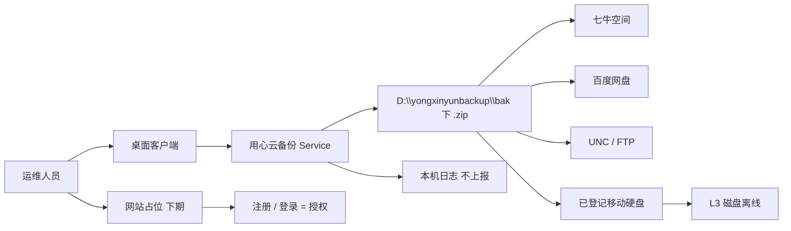
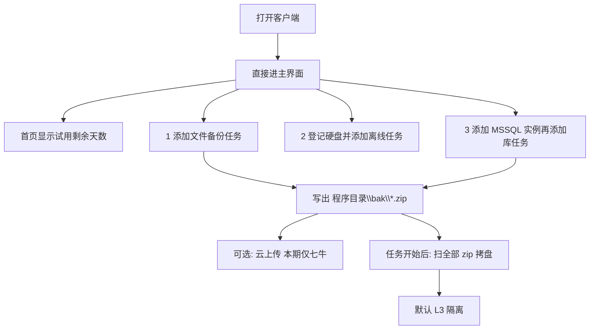
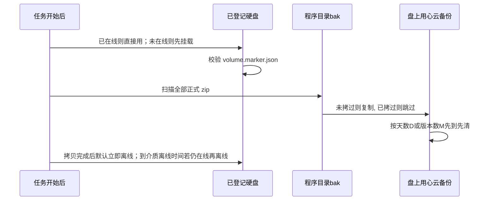
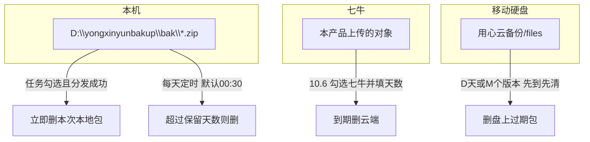
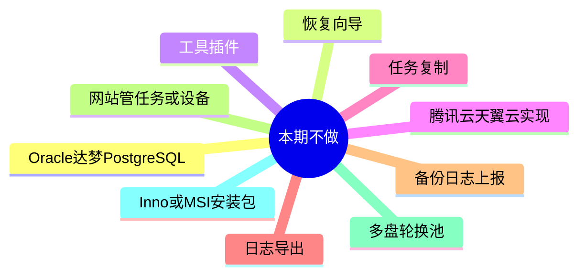

# 用心云备份 · 本期成果预览

下文是早期客户端范围。当前对外地址：

- 官网 https://backup.yongxincloud.cn 。客户端左下角「官网」打开这个地址。
- 安装包 http://download.yongxinyun.com/yongxinyunbackup/yongxinyunbackup.zip 。营销页可直接下载。
- 公司：常州用心软件有限公司，电话 400-051-9608，邮箱 market.yongxinyun.com。备案：苏ICP备19043516号-6，苏公网安备32041102001697号。
- 营销站和厂商后台使用墨色 `#1C1214` 与正红 `#DC0606`。客户端主题增加「用心云」，默认仍是明亮。
- 厂商后台可删除非服务商客户。登录默认连 https://backup.yongxincloud.cn ，可用客户端 `data\site.url` 覆盖。
- 2026-10-05（下午）：任务时间改日期+时间选择；MSSQL/MySQL 多库 zip 带库名；立即执行运行锁，避免打出两份包；日志可滚动、可清空、增加 MySQL 与百度分片页；百度上传弹出实时分片窗，文件在 `data\baidu-upload\`（文件名含 zip 名）；授权分 **扫码授权** / **帐号密码**，成功后关授权窗。尚未收口见开发计划第 9 节。
- 2026-10-05：登录默认官网 HTTPS、TLS 1.2。立即执行后台跑。云备份改为上行/下行限速（引擎共用）。百度 4MB 分片续传、片间限速。2012 R2 登录需官网 Nginx/SLB 打开 CBC 兼容套件。操作与部署见手册。
- 2026-10-04：网站只收支付宝，账号信息含个人资料和开票资料，开票勾选有金额的未开票支付记录。客户端登录按资料显示公司和个人，否则显示邮箱。备份目录默认 `D:\yongxinyunbackup\bak`。实例和任务已开通 MySQL。百度网盘可授权（浏览器可扫码）、4MB 分片断点续传、按天删除；云列表不再写「本期可用」。EMAIL 在 SMTP 配好后出现总开关和失败/成功/所有；任务仍须勾「完成后发邮件」。首页未登录可点「申请帐号」打开官网注册。综合设置可配日志保留天数。操作细节见《用心云备份-操作手册》。

**依据：** [用心云备份-PRD.md](用心云备份-PRD.md)  
**开发计划：** [用心云备份-开发计划.md](用心云备份-开发计划.md)  
**配置：** [用心云备份-配置手册.md](用心云备份-配置手册.md)（支付宝、百度）  
**部署：** [Linux](用心云备份-Linux部署手册.md) / [Windows](用心云备份-Windows部署手册.md)（含官网 443 套件注意项）  
**用途：** 用图看清做完后软件长什么样、数据怎么走。细节以 PRD 为准。

---

## 1. 一句话

Windows 客户端在本机打 `.zip`，可选传到七牛 / UNC / FTP，再到任务开始时间把包拷到已登记移动硬盘并隔离。首页显示 30 天试用倒计时；**本期到期只提示、不拦截**。无公网网站，登录按钮占位。下期无有效授权时，文件备份、数据库备份、云、UNC、FTP、邮件按授权停止；**离线介质无网仍可执行**。试用改为订单系统购买：每客户最多 2 次，第 1 次 0.1 元、第 2 次 0.5 元，各 30 天，走支付。续费从原到期日顺延。

本期只做三件事，顺序固定：

1. 文件备份
2. 离线介质
3. MSSQL

---

## 2. 做完后你能看到什么



| 你打开 | 能做 | 看不到 / 不能做 |
| --- | --- | --- |
| 客户端 | 新增、修改、删除文件任务与 MSSQL/MySQL 任务；立即执行；离线介质；云；恢复（库）；我的设备；看首页和日志 | 任务复制、工具插件、文件包恢复向导 |
| 网站 | 本期无公网站；客户端「登录」为占位 | 注册与授权下期做。备份日志只留本机，网站不查 |
| 资源管理器 | 默认在 `D:\yongxinyunbackup\bak` 看到 `.zip` | 隔离后的移动硬盘盘符（默认 L2 卷离线） |

---

## 3. 客户端主界面（左侧导航）

```text
┌─────────────┬──────────────────────────────────────────────┐
│ 用心云备份   │  首页                                        │
│             │  ┌────────┐ ┌────────┐ ┌────────┐ ┌────────┐ │
│  首页       │  │文件任务 │ │库任务  │ │当日错误│ │引擎    │ │
│  任务       │  │ N / 已执行│ │ N / 已执行│ │自动/手动│ │安装/启动│ │
│  离线介质 ★ │  └────────┘ └────────┘ └────────┘ └────────┘ │
│  云备份     │                                              │
│  实例       │                                              │
│  日志       │                                              │
│  恢复       │                                              │
│  我的设备   │                                              │
│  设置       │                                              │
│             │                                              │
│ 官网  登录  │                                              │
└─────────────┴──────────────────────────────────────────────┘
```

- **本期可点：** 首页、任务（文件 / MSSQL / MySQL）、离线介质、云备份、实例、日志、恢复（MSSQL / MySQL 库）、我的设备、设置。
- **灰掉或提示后续：** 任务和实例里的 Oracle / 达梦 / PostgreSQL、云备份里的腾讯云/天翼云。已去掉「工具」。

---

## 4. 三条主能力怎么用



未登录、断网也能备份、传 UNC/FTP、发邮件、上传七牛、拷移动硬盘。试用到期本期只提示。登录占位、无日志上报。离线菜单不被登录页挡住。

---

## 5. 文件备份（先做）

**入口：** 任务 → 文件 → 添加

```text
添加文件备份任务
  [基本设置]  [计划周期]  [任务设置]

  名称
  源: 本地 / UNC / FTP
  文件夹  [选择]
  启用

任务设置: 网络(UNC必通) / FTP(必通) / 云上传(选已配置服务商) / 立即删本次(默认不勾) / 邮件(必通)
```

成果：按周期把源文件夹打成 `.zip`，落到 `<程序目录>\bak`。

---

## 6. 离线介质（第二做）

**入口：** 左侧独立菜单「离线介质」（不是任务页签）



**你在界面上配的：** 任务名、已登记的那一块盘、任务开始时间、介质离线时间、等待就位、保留天数 D（默认 7）、版本数 M（默认 7）、隔离等级（默认 L2 卷离线）、完成后立即离线（默认勾选）、可选巡检 SHA-256（默认关）。扫描源默认为备份目录，也可另选。每任务 1 块盘，无轮换池。

**盘上长这样：**

```text
E:\用心云备份\
  files\          按相对 bak 的目录存 zip，每个包一份
  versions\       每次执行一张清单
  .yxybackup\volume.marker.json
```

拷完后资源管理器里看不到这块盘（默认 L2 卷离线）。未登记盘、别人登记的盘、系统盘一律不写。

---

## 7. MSSQL（第三做）

**入口：** 实例 → 添加 MSSQL；任务 → MSSQL → 添加

```text
实例: 名称 / localhost / 端口 / Windows或sa / 连接测试
      （SQL Server 2008 R2～2022）
任务: 选实例 → 完整备份 → 计划 → 全部库或不含系统库或勾选库
      → 可选云上传(七牛) / 立即删本次(默认不勾)
```

成果：库备份同样打成 `.zip` 进同一个 `bak` 目录，离线任务到任务开始时间后会一起扫走。

---

## 8. 数据落在哪、谁来删



| 位置 | 怎么删 | 默认 |
| --- | --- | --- |
| 本机当次包 | 任务勾选「立即删」；网络/FTP/七牛/邮件（已启用的）都成功才删 | **不勾**（留给离线扫） |
| 本机历史包 | 设置 → 自动删除 → 本机保留天数 | 7 天 |
| 七牛历史包 | 设置 → 自动删除 → 勾选七牛 + 天数 | 不勾则只传不删 |
| 移动硬盘 | 离线任务自己的 D 天 + M 个版本 | 都是 7 |

勾「立即删」会提示：离线介质可能拷不到本次包。不删任务配置，只删备份文件。

---

## 9. 网站（本期占位）

```text
客户端点「登录」
┌────────────────────────────┐
│  授权登录后续开通            │
│  本机试用还剩 N 天（到期不拦截）│
└────────────────────────────┘
本期没有: 注册页、浏览器回传、网站日志列表
```

下期才做：浏览器登录回传、授权缓存、试用订单（第 1 次 0.1 元、第 2 次 0.5 元，各 30 天，走支付）。备份日志不上报。到期后有 7 天宽限期，续费从原到期日顺延。离线介质无网仍可执行。规则见 PRD 第 2 节和《用心云备份-后台系统开发需求文档》。

---

## 10. 设置页（客户端）

本期页签：

`备份存储` · `备份命名` · `网络传输` · `FTP` · `EMAIL` · `自动删除` · `综合设置`

云密钥不在设置页。左侧「云备份」菜单：

```text
云备份
  七牛云     空间 / AK / SK / 连接测试     可用（客户自填）
  百度网盘   浏览器授权（可扫码）/ 启用    可用（厂商 App，token 本机加密）
  腾讯云     后续开通                      禁用
  天翼云     后续开通                      禁用
```

任务里只勾「云上传」并选择已启用的服务商（一项就绪则直接用，多项则下拉）。EMAIL：SMTP 主机、发件人、收件人都填了才显示「任务执行后发送邮件」和下拉失败/成功/所有；任务还要勾「完成后发邮件」。

**备份存储默认路径：**

```text
程序在  D:\yongxinyunbakup
备份在  D:\yongxinyunbakup\bak
```

换盘安装则跟着程序目录变，不写死 `C:\bak`。

---

## 11. 日志页

页签：文件备份、MSSQL、MySQL、离线介质、自动删除、百度分片。点选一行后下方可滚动看完整说明。每页有 **刷新**、**清空日志**（不清备份包）。无导出。百度分片同时写 `data\baidu-upload\` 下带 zip 名的 `.log`，打开该页约每秒刷新。

| 页签 | 你能看到 |
| --- | --- |
| 文件备份 | 任务、结果、时间、执行模式 |
| MSSQL / MySQL | 实例、任务、结果、完整说明 |
| 离线介质 | 任务开始、介质离线、序列号、挂载、复制/跳过字节、删版本、隔离结果 |
| 自动删除 | 执行模式、时间；云对象删除成功记「删除调用成功：对象名」 |
| 百度分片 | 分片过程；并显示 `data\baidu-upload\` 文本 |

本期只看本机。下期已登录后同一套列表可出现在网站上。

---

## 12. 本期不做（避免误当成交付）



---

## 13. 实现顺序与可演示成果

| 顺序 | 做完后现场能演示 |
| --- | --- |
| 1 文件备份 | 选一个文件夹，可点立即执行，或到期后 `程序目录\bak` 出现 `.zip` |
| 2 离线介质 | 插已登记盘，到任务开始时间后自动拷包；默认拷完即离线，介质离线时间若仍在线再离线一次 |
| 3 MSSQL | 连上实例，库备份 `.zip` 进同一 bak，到任务开始时间后一并拷走 |
| 并行 授权 | 首页倒计时；到期只提示；登录按钮占位 |
| 并行 传输 | 任务勾选后能拷 UNC、传 FTP、发邮件；任一项失败不立即删本地 |
| 并行 清理 | 本机 / 七牛按天少包；硬盘按天或按次数少包 |

详细字段、校验和验收条文见 [用心云备份-PRD.md](用心云备份-PRD.md)。
